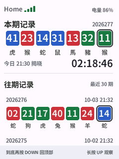
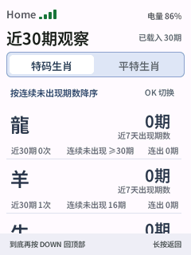

<p align="right"><strong>简体中文</strong> · <a href="README.md">English</a></p>

# NineHalf

NineHalf 是为 FoloToy AI Passport 制作的数字游戏看板，在设备的 240 × 320 屏幕上展示本期记录、往期数字和生肖观察。

| 本期与往期记录 | 近 30 期观察 |
| --- | --- |
|  |  |

*图片为原生渲染预览；更多页面可查看[交互设计预览](design-preview/index.html)。*

## 主要功能

- 展示本期、倒计时，以及最近 30 期记录。
- 将前六个数字（平特）和第七个数字（特码）分组呈现。
- 基于已载入的最近 30 期，查看生肖出现次数、近期出现情况和连续未出现期数。观察结果只描述历史记录，不自动推荐下一期数字。
- 在设备本地保存记录，离线时仍可查看；最多保存五组 Wi-Fi，供设备自动重连。
- 支持新一期提醒，并可在设备上调节音量和亮度。

## 按键与配网

首页使用 UP/DOWN 浏览记录，短按 OK 刷新。长按 UP，或在首页顶部短按 UP，进入观察页；长按 DOWN 进入设置。其他页面长按 OK 返回。

配网时进入**设置 → 重新配网**，再通过「蓝牙配网-FoloToy AI PASSPORT」微信小程序连接 **2.4 GHz Wi-Fi**。已保存的网络可在**设置 → Wi-Fi 管理**中手动选择或删除。

详细操作与数据规则见[应用说明](docs/apps/ninehalf.zh_CN.md)。

## 构建与预览

目标硬件为 **ESP32-C3、8 MB Flash、无 PSRAM**。激活 **ESP-IDF 5.5.3** 后运行：

```sh
./tools/validate.sh
```

验证后的合并固件为 `build/ai-passport-ninehalf-full.bin`，从 `0x0` 刷写。刷机前请核对[固件布局与数据保留策略](docs/development/engineering/firmware-layout.zh_CN.md)。

在本地查看交互设计预览：

```sh
python3 -m http.server 8765 --directory design-preview
```

打开 `http://127.0.0.1:8765/`。其他项目和开发资料见[文档索引](docs/README.zh_CN.md)。
